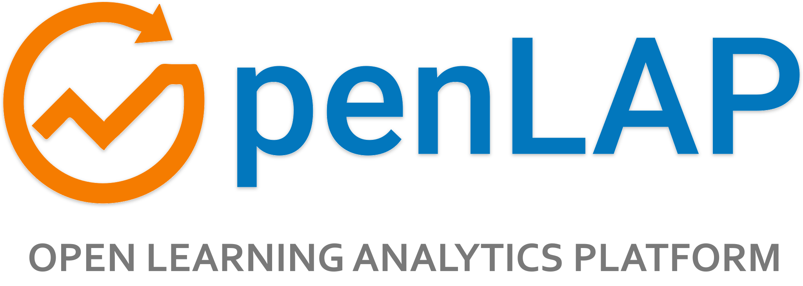
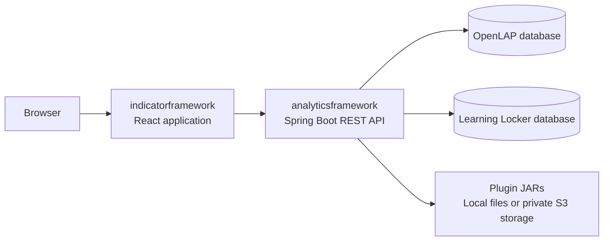

<p align="center">
  
</p>

<h1 align="center">Open Learning Analytics Platform</h1>

<p align="center">Design learning analytics together. Turn learning data into meaningful indicators.</p>

<p align="center">
  <a href="https://openlap.de/"><strong>Production</strong></a> ·
  <a href="https://edge.openlap.de/"><strong>Edge preview</strong></a> ·
  <a href="#local-installation">Install locally</a> ·
  <a href="#documentation">Documentation</a>
</p>

<p align="center">
  <a href="https://github.com/ude-soco/openlap-official/actions/workflows/ci.yml"></a>
  <a href="https://github.com/ude-soco/openlap-official/actions/workflows/javascript.yml"></a>
  <a href="LICENSE"></a>
</p>

OpenLAP is an open-source platform for **human-centered learning analytics**. It helps
learners, educators, and researchers design indicators around their questions, connect
learning activity data, apply analytics methods, and explore the results through visualizations.
The project is developed by the [Social Computing Group at the University of Duisburg-Essen](https://www.uni-due.de/soco/).

## Explore OpenLAP

| Environment | Address | Purpose |
| --- | --- | --- |
| **Production** | [openlap.de](https://openlap.de/) | The public production installation. |
| **Edge** | [edge.openlap.de](https://edge.openlap.de/) | Preview installation for testing and reviewing changes. |

See [releases](https://github.com/ude-soco/openlap-official/releases) for release notes.
Deployment promotion is managed separately from source changes; a merge alone does not
confirm that an environment has finished updating.

## What you can do

- **Design indicators:** use Indicator Specification Cards to connect learning goals,
  questions, data requirements, and visualization choices.
- **Build analytics:** select an xAPI dataset, filter activities, choose an analytics method,
  and preview or save an indicator. Combine indicators for broader analyses.
- **Administer the platform:** manage users, plugin catalogs, and audit logs. Configured
  S3 storage enables plugin upload, version, and recovery workflows.
- **Publish homepage content:** edit news and publications with rich text, private drafts,
  previews, and explicit publication to the homepage.

## Architecture and stack



| Component | Current stack |
| --- | --- |
| [`indicatorframework/`](indicatorframework/) | React 19, MUI 9, MUI X 9, Vite 8, React Router 7, ApexCharts 8, Tiptap 3 |
| [`analyticsframework/`](analyticsframework/) | Spring Boot 4.1, Spring Security 7, Spring Data MongoDB; REST API under `/api` |
| Java and build | Java 17 minimum; Java 25 LTS qualified. Maven 3.10 wrapper included. |
| JavaScript runtime | Node 22 locally and in frontend regression CI, selected by `.nvmrc`; the frontend container build uses Node 26.13. |
| Data and plugins | Separate OpenLAP and Learning Locker MongoDB databases; local JARs or configured S3-compatible storage. |

The backend retains a Jackson 2 compatibility bridge for existing API, stored-data,
and plugin contracts. See the [backend reference](docs/backend-reference.md).

## Local installation

The recommended setup runs MongoDB in Docker and both applications on your computer.
These shell commands target **macOS, Linux, or WSL2** using Bash or Zsh.

### 1. Install prerequisites and clone

| Tool | Requirement |
| --- | --- |
| [Git](https://git-scm.com/downloads) | Clone the repository. |
| [Java JDK](https://docs.aws.amazon.com/corretto/latest/corretto-25-ug/downloads-list.html) | Java 25 LTS recommended; Java 17 minimum. Set `JAVA_HOME` to the intended JDK. |
| [Node.js and npm](https://nodejs.org/en/download) | Node 22 (22.12 or newer), matching `indicatorframework/.nvmrc`. [nvm](https://github.com/nvm-sh/nvm) is optional. |
| [Docker with Compose](https://docs.docker.com/get-started/get-docker/) | Docker Desktop or Docker Engine with the Compose plugin. Start Docker first. |
| [Python 3](https://www.python.org/downloads/) | Python 3.9 or newer for startup and verification helpers. |

A global Maven installation and a particular IDE are not required. IntelliJ IDEA
and VS Code can import `analyticsframework/pom.xml` directly.

```bash
git clone https://github.com/ude-soco/openlap-official.git
cd openlap-official
```

### 2. Start a fresh local database

**Already have development data?** Keep its MongoDB server running, skip this step,
and configure its addresses and database names below. The supplied Compose setup uses
MongoDB 7; attaching an older database volume does not upgrade it.
See [existing installations](#existing-installations).

For a fresh installation, choose a new volume name. From the repository root:

```bash
cd analyticsframework
docker volume create openlap-local-mongo
export OPENLAP_MONGO_VOLUME=openlap-local-mongo
python3 -B scripts/start-local-mongo.py
```

The helper starts only MongoDB on port **27017**, after checking the explicitly selected
volume. Data survives container restarts. This development configuration publishes
MongoDB to the host and is intended for your local machine.

### 3. Run the backend

In the same terminal, from `analyticsframework/`:

```bash
./mvnw -version

ALLOW_INSECURE_DEFAULTS=true \
PORT=8090 \
MONGODB_PRIMARY_URI=mongodb://127.0.0.1:27017 \
OPENLAP_MONGODB_DB=openlap_v2 \
MONGODB_SECONDARY_URI=mongodb://127.0.0.1:27017 \
LRS_MONGODB_DB=learninglocker_v2 \
WEBAPP_URL=http://localhost:5173 \
./mvnw spring-boot:run
```

The first run downloads dependencies and compiles the backend. Check that the wrapper
reports the intended JDK. Both clients deliberately use one MongoDB server with
**different database names**. The normal secondary-server default is port `27018`,
so keep the explicit override for this setup.

`ALLOW_INSECURE_DEFAULTS=true` permits the built-in development credentials. Use it
only locally; deployed installations require their own secrets.

The API is available at **[http://localhost:8090/api](http://localhost:8090/api)**.
From another terminal, check a public endpoint:

```bash
curl --fail http://localhost:8090/api/v1/content/news
```

An empty list is expected for a new database. The API base path is not a homepage;
Actuator health endpoints require authentication.

### 4. Run the frontend

Open another terminal at the repository root. If you use nvm, run
`nvm install && nvm use` from `indicatorframework/` before installing packages;
this reads the checked-in `.nvmrc`.

```bash
cd indicatorframework
npm ci
VITE_BACKEND_URL=http://localhost:8090/api/ npm run dev -- --port 5173 --strictPort
```

Open **[http://localhost:5173](http://localhost:5173)** and keep both application terminals
running. If 5173 is occupied, stop the old frontend or choose a new port and update
`WEBAPP_URL` to match.

To persist frontend settings, copy [`indicatorframework/example.env`](indicatorframework/example.env)
to a local `.env.local` file and set `VITE_BACKEND_URL`, preserving existing configuration.
Restart Vite after env changes. EmailJS is optional for running OpenLAP; configure
its settings to send contact-form messages.

### 5. Sign in and prepare data

On first startup, the local seed administrator is **`admin@mail.com` / `1234qweR`**.
Explore **Administration → Admin Dashboard** and **Content Management**. News and
publications can be created immediately, or imported through the optional
[one-time content migration](docs/backend-reference.md#homepage-content-management).

A fresh checkout contains **no learning records or plugin JARs**. To create analytics,
you also need:

1. Learning Locker store metadata and xAPI statements in the secondary database.
   This Compose setup starts MongoDB; it does not install Learning Locker.
2. Trusted analytics and visualization plugins. Local mode reads
   `analyticsframework/jars/analytics_techniques/` and `analyticsframework/jars/visualization_methods/`.
   For S3 mode, follow [artifact setup and migration](docs/plugin-artifact-migration.md)
   and the [admin upload workflow](docs/plugin-upload-workflow.md).
3. Register a separate user account and link its LRS and actor identifier through **Settings → Manage LRS**.
   The seed administrator has the admin role; indicator creation requires the separate `USER` role.

<details>
<summary>Stopping and restarting local services</summary>

Stop the backend and frontend with **Ctrl+C**. From `analyticsframework/`, stop MongoDB
with the same selected volume:

```bash
export OPENLAP_MONGO_VOLUME=openlap-local-mongo
docker compose --project-name analyticsframework \
  -f compose.yaml -f compose.dev.yaml stop mongo
```

Restart MongoDB with `python3 -B scripts/start-local-mongo.py`, then rerun the application
commands. Keep the external volume when stopping or rebuilding.

</details>

## Configuration

| Setting | Purpose | Quickstart value |
| --- | --- | --- |
| `PORT` | Backend HTTP port | `8090` |
| `MONGODB_PRIMARY_URI` | OpenLAP MongoDB server | `mongodb://127.0.0.1:27017` |
| `OPENLAP_MONGODB_DB` | Application database name | `openlap_v2` |
| `MONGODB_SECONDARY_URI` | Learning Locker MongoDB server | `mongodb://127.0.0.1:27017` (default is `27018`) |
| `LRS_MONGODB_DB` | Learning Locker database name | `learninglocker_v2` |
| `WEBAPP_URL` | Allowed frontend origin | `http://localhost:5173` |
| `VITE_BACKEND_URL` | Frontend API URL, including `/api/` | `http://localhost:8090/api/` |
| `PLUGIN_STORAGE_MODE` | Backend plugin storage | `local`; `s3` requires explicit setup |

Database-name settings select the database even when a URI includes a different path.
Spring Boot **does not automatically load backend `.env` files**: export values or set
them in your IDE. The [backend environment example](analyticsframework/.env.example)
documents supported settings.

## Existing installations

- Keep your current MongoDB server and set the right URIs **and** database names. A new
  empty database can look like missing users, content, or LRS data.
- Match MongoDB's version to its data files. The startup helper verifies volume ownership,
  not data-format compatibility; database upgrades require a separate migration.
- Restore plugin binaries as well as database metadata. Run the backend from
  `analyticsframework/` so recorded relative JAR paths resolve; see [artifact migration](docs/plugin-artifact-migration.md).
- Before replacing the former `openlap-analyticsframework` / `openlap-indicatoreditor`
  deployment names, follow the [framework naming migration](docs/framework-renaming.md).

## Development checks

From the repository root, with the JDK and Node version selected above:

```bash
(cd analyticsframework && ./mvnw package)
(cd indicatorframework && npm test && npm run build)
python3 -B tests/test_maven_wrapper.py
python3 -B tests/check_backend_toolchain.py
```

The frontend build is written to `indicatorframework/dist/webapp/`. `npm run lint` is
also available; existing repository-wide findings mean it is not a clean baseline.
CI additionally checks packaged startup, browser interactions, historical chart plugins,
object storage, and backup/recovery helpers.

## Troubleshooting

| Symptom | Check |
| --- | --- |
| Java version or class-file error | Compare `java -version` and `./mvnw -version`; correct `JAVA_HOME`. Java 11 is no longer supported. |
| Insecure-default startup rejection | Use the local waiver above, or configure your own admin password and JWT secret. |
| MongoDB port 27017 is occupied | Reuse the intended MongoDB server and set its connection URIs. A different MongoDB port needs matching port mapping and URI settings. |
| Backend port 8090 is occupied | Stop the old backend, or change `PORT` and `VITE_BACKEND_URL` together. |
| Frontend requests fail or reach Vite | Use the absolute API URL with `/api/`, align ports and `WEBAPP_URL`, then restart Vite. No automatic development API proxy is configured. |
| No LRS or activity data | Check the secondary URI, database name, stored xAPI records, and the user's LRS link. A fresh database is empty. |
| Listed method/chart cannot load inputs | Restore its recorded JAR or finish the S3 migration; keep the backend working directory consistent. |

## Documentation

| Topic | Guide |
| --- | --- |
| Backend configuration, errors, content API and migration | [Backend reference](docs/backend-reference.md) |
| Homepage components, themes and editorial guidance | [Landing-page guide](docs/landing-page.md) |
| Frontend architecture | [UI architecture](indicatorframework/docs/UI_ARCHITECTURE.md) |
| Content editing and review | [Content management](docs/content-management-testing.md) |
| Authentication | [Token policy](analyticsframework/docs/AUTH_TOKEN_POLICY.md) |
| Plugin storage | [Artifact migration](docs/plugin-artifact-migration.md) · [S3-compatible storage](docs/plugin-storage-versity.md) |
| Plugin administration | [Upload](docs/plugin-upload-workflow.md) · [Versions](docs/plugin-version-management.md) · [Removal and recovery](docs/plugin-removal-and-retention.md) |
| Deployment naming and storage identities | [Framework migration](docs/framework-renaming.md) |

## Contribute and learn more

Report reproducible problems or discuss features in [GitHub Issues](https://github.com/ude-soco/openlap-official/issues).
For code changes, create a branch, run the relevant checks, and open a pull request with
the change and its validation. Keep credentials and local environment files out of commits.

Explore the [research project](https://www.uni-due.de/soco/research/projects/openlap.php)
and [publications](https://openlap.de/publications).

OpenLAP uses the [MIT license](LICENSE). Dependencies and separately installed plugins
retain their own license terms.
