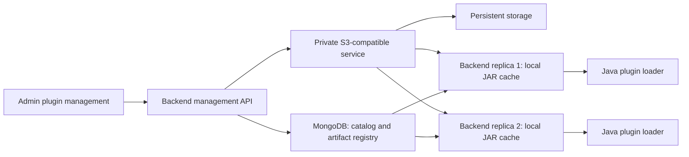

# Issue #1: plugin management with S3-compatible storage

Status: lifecycle protections implemented on `feat/shoeb-plugin-management-s3`;
edge storage pilot deployed and verified; backend artifact integration next.
Updated: 2026-11-08.
Issue: [Create an admin panel #1](https://github.com/ude-soco/openlap-official/issues/1).

This is the current plan for the remaining analytics and visualization management
work. The earlier [management audit](./admin-dashboard-management-plan.md) is
historical and includes gaps that have since been fixed.

## Scope and current baseline

| Issue requirement | Current implementation | Remaining work |
| --- | --- | --- |
| Manage analytics methods | Admin catalog, input/parameter inspection, usage counts, enable/disable | Add, edit metadata, upload replacement versions, safe deletion |
| Manage visualization methods | Admin library/type catalogs, inspection, usage counts, enable/disable | Add libraries/types from JARs, edit metadata, upload replacement versions, safe deletion |
| Upload and add methods | Legacy backend upload routes and unrouted legacy UI exist | Validated upload/review/activation workflow backed by durable object storage |
| Delete and update methods | Legacy delete routes now reject removal; enable/disable remains available | Reference checks, shared-artifact protection, version handling, confirmations and recovery |
| Dashboard showing methods in use | Counts per item from saved indicators and distinct creators | Overview with totals, most-used methods and unused items, with clear metric labels |

Admin routing, role guards, audit logging and soft-disable are already available.
The current code also validates plugin filenames and restricts legacy reload and
populate routes to SUPER_ADMIN. Those fixes are prerequisites to preserve, not
features to rebuild.

Uploads still write local files, but now validate a staged archive and reject an
existing filename without overwriting it. Both Java loaders need a local JAR and
now resolve the recorded file instead of scanning unrelated JARs for the same
class. Backend replicas do not currently mount plugin storage.

## Implementation progress

The first increment establishes local lifecycle protections:

- Static archive inspection bounds uploaded and expanded size, rejects unsafe
  archive paths, checks entry integrity and requires class entries. It does not
  execute or certify plugin code; contract inspection and activation follow later.
- Publication uses atomic create-if-absent semantics, including concurrent uploads
  and symlink targets. Existing files remain unchanged and staging files are
  cleaned up after failure.
- Runtime loading uses each catalog entry's recorded JAR, with independent
  classloaders for different artifact paths. Retired versions still execute, and
  loaders remain available for lazy dependency loading until application shutdown.
- The five legacy delete operations return HTTP 409 / `PLUGIN_DELETE_UNAVAILABLE`
  before accessing catalog records or files. This temporary restriction prevents
  dangling references and shared-JAR deletion until the guarded removal workflow
  in phase 6 is implemented. Enable/disable controls are unchanged.

These changes are not yet deployed. Before deploying strict JAR-path resolution,
inventory existing database paths and artifacts as described under Migration and
rollback; inconsistent historical paths now fail explicitly instead of silently
loading a different binary. Artifact migration, backend S3 integration, modern
management workflows and the usage overview remain pending.

The edge storage pilot was deployed and verified on 2026-11-08 through the private
continuous-delivery repository:

- The new persistent volume is Bound with 5 GiB requested capacity and
  ReadWriteOnce access using the existing local-path provisioner. The storage
  workload schedules and runs within the namespace's current permissions.
- The private bucket grants its application key read/write access, with bucket
  creation and ownership denied. Administration and application credentials are
  separate, and namespace NetworkPolicy isolation is exercised by the live tests.
- Both independent cluster test clients completed checksum-verified JAR round
  trips, anonymous-access rejection and administration-port isolation checks.
- A second rollout replaced the healthy storage pod. Both clients had to read
  the original JAR before any upload, and the rollout completed Healthy/Synced.
  The existing-object check remains enabled for later rollouts.
- All 15 pilot resources passed isolated schema validation with synthetic
  credentials. The exact container images also passed a local cold-backup and
  restoration exercise. A real off-node cluster backup destination and production
  availability design remain outstanding release requirements.

The application has not yet been connected to the bucket, and existing plugin
JARs have not been migrated. Production resources and application image pins
were not changed by the pilot. The next implementation unit is the artifact
registry, verified local cache and explicit migration path in phase 3.

## Storage and execution design

- Host the S3-compatible service inside the existing Kubernetes cluster, using
  the existing OpenLAP GitOps application and namespace resources. Keep its API
  internal; browser clients use the backend rather than storage credentials.
- Use separate edge and production buckets and scoped service credentials.
  Bootstrap administration credentials are separate from backend object access.
- Store immutable JAR objects under generated keys containing plugin kind,
  artifact identity and checksum. Original filenames are display metadata, not
  storage paths or overwrite targets. Application-managed versions must work
  without depending on native S3 bucket versioning.
- Add a proposed `plugin-artifact` collection for artifact/version identity,
  object key, SHA-256 checksum, size, discovered entry classes, lifecycle state,
  uploader and timestamps. Existing catalog records reference an artifact ID.
  One JAR may supply several methods or visualization types.
- Each replica downloads missing artifacts into a temporary cache file, checks
  size/checksum, and atomically exposes the completed file to the loader.
  Coordinate concurrent downloads and bound cache growth. Cache contents are
  disposable and must never become the only copy of an uploaded JAR.
- Resolve the artifact version through shared database state on each execution,
  or an explicitly refreshed metadata cache. Loader/cache keys include artifact
  identity, preventing one replica from continuing to use an overwritten JAR.
  Release classloaders and cached files only after active executions finish.
- Cached, verified artifacts can continue serving during a storage outage.
  Missing artifacts return a clear error; cold starts must not silently omit
  required installed methods. Storage errors must never trigger catalog deletion.

## Verified feasibility and pilot constraints

The read-only Argo CD inspection on 2026-11-08 established:

- Sync permission exists for the current OpenLAP edge and production apps.
- Creation of a separate OpenLAP storage application is denied.
- The project permits namespace resources in `openlap-official-*` destinations,
  with the existing continuous-delivery repository as an allowed source.
- Cluster-wide resources are not allowed by the project. Avoid a new operator,
  CRD, ClusterRole or StorageClass in this plan.
- An existing edge Mongo PVC is Bound with `local-path`, provisioned by
  `rancher.io/local-path`, using ReadWriteOnce access.

The subsequent pilot proved that its PVC, workload and two test clients can be
provisioned under the current namespace permissions and scheduling constraints.
It does not establish capacity for unrestricted future growth or a node-failure
availability guarantee. A requested PVC size is not evidence of free physical
disk or an enforced filesystem limit.

The pilot selected Garage v2.5.0 using a plain StatefulSet without Kubernetes
discovery CRDs. Its official release and job images are digest-pinned. The service
uses a non-root init step to prepare private service-owned credential files and
requires no new Kubernetes API permissions. Backend SDK compatibility will be
tested during the application integration unit.

A single storage instance using local-path is suitable for proving integration.
Production needs an explicit availability decision, an off-node backup location,
and a successful restore test. If availability during node failure is required,
verify a replicated storage design across independent nodes or obtain a suitable
storage service from the platform team. Protect data PVCs from accidental Argo
pruning and application deletion, and document recovery and capacity monitoring.

## Management behavior

### Upload and activation

Only trusted SUPER_ADMIN maintainers can upload plugin code. Plugin execution
runs with backend privileges; JAR-format, checksum and interface checks do not
provide a sandbox or prove the code is safe. Running untrusted plugins in isolated
workers is a separate architecture project.

Use a staged workflow: upload, inspect, review, activate. Enforce file/request size
and decompression limits, valid JAR structure, safe paths, required interfaces and
constructors, supported plugin contracts and nonempty discovered entries. Separate
static inspection from any initialization that executes plugin code. Report
specific errors instead of returning success after partial discovery.

Show the discovered methods/libraries/types and duplicate/conflict information
before activation. Uploading the same bytes again is idempotent. Never overwrite
an active artifact because its filename matches.

S3 and MongoDB do not share a transaction. Use persisted operation states,
conditional updates and retryable operations so partial uploads or catalog writes
cannot expose a half-installed plugin. Do not assume MongoDB transactions are
available in the deployed topology. Clean up abandoned staging objects only after
a retention period and a reference check.

### Update and version policy

- Metadata edits preserve catalog IDs and artifact bytes. Define editable fields
  per entity, and keep them separate from JAR-derived classes, inputs, outputs
  and chart configuration. Rescanning must not overwrite admin metadata edits.
- A JAR replacement is an immutable artifact revision with new catalog records.
  Existing indicators keep their original references and behavior.
- Activating a replacement can retire the previous version from new selections
  using the existing soft-disable mechanism. Preserve intentional per-item
  disabled states; present an explicit old-to-new mapping when a JAR supplies
  several entries. The complete replacement must be valid before retirement.
- Interface-breaking changes remain distinct versions. Existing indicators are
  not automatically migrated. Version history and activation state make this
  behavior visible to admins.
- A failed replacement leaves the currently installed version usable. Concurrent
  admin changes use optimistic conflict checks and actionable retry messages.

This avoids adding automatic indicator-version migrations to the first release.

### Delete and dependency protection

- Keep Disable as the routine way to retire an item while preserving existing
  indicators.
- Permit deletion only when authoritative server-side checks find no references.
  Audit saved indicators, persisted drafts and other stored configurations;
  current dashboard counts cover saved indicators only and are not sufficient
  as the sole deletion guard.
- For a visualization library, check all contained types. Deleting one method or
  type must not remove a JAR that still supplies other installed entries.
- Coordinate deletion with new-reference creation and concurrent management
  operations. Recheck dependencies on submission; a disabled UI button is not
  enforcement. Old selection requests must not introduce dangling references.
- Remove items from selectable catalogs first. Retain artifact bytes for a
  documented recovery period; purge later only if no catalog, version or pending
  operation needs them. Record cleanup failures and retry them.
- Route legacy upload/delete/reload/populate entry points through the same
  lifecycle rules, or explicitly retire them. They must not bypass the new
  storage or reference protections or recreate removed catalog entries.

## Admin experience and usage dashboard

Use the existing admin pages and MUI components for both plugin kinds. Provide
clear Add, Edit details, Upload new version, Enable/Disable and Delete actions.
Group versions under their plugin so the table remains understandable.

The upload flow shows progress, validation results, a review of discovered entries
and the activation result. Preserve user input on recoverable failures. Provide
inline guidance, keyboard access, focus management, accessible error/status
announcements, unsaved-change handling, and specific dependency explanations.
Deletion confirmation names the affected entries and offers Disable when removal
is blocked. Reuse sorting, search, pagination and per-row busy states.

Extend the overview with installed/enabled/disabled totals, most-used methods,
unused entries and links to filtered catalog pages. Label the existing measures
as saved-indicator references and distinct indicator creators. Refresh all related
usage data after changes. These are not execution counts, active-user telemetry
or historical trends; collecting those is outside the issue's first release.

Extend audit events to cover upload, validation, activation, metadata changes,
replacement, delete and cleanup outcomes, including relevant version/checksum
identifiers without credentials or JAR contents.

## Implementation sequence and review units

| Order | Repository / MR | Scope and completion condition |
| --- | --- | --- |
| 1 | OpenLAP: lifecycle protections | Verify existing auth/path fixes; close overwrite and unsafe-delete bypasses; establish shared lifecycle rules and error contracts. No new upload UI yet. |
| 2 | Continuous delivery: edge storage pilot | Select/configure provider without cluster-wide dependencies; provision storage/internal service; verify scoped object access, quota/capacity, persistence and backup/restore. Production remains untouched. |
| 3 | OpenLAP: artifact registry, cache and migration | Add storage abstraction, immutable registry, per-replica cache/loader lifecycle and idempotent import. Demonstrate the same plugin works on both replicas after replacement of a pod. |
| 4 | OpenLAP: add/upload workflow | Deliver validated upload/review/activation APIs and matching analytics/visualization UI; test partial failures and audit outcomes. |
| 5 | OpenLAP: metadata and version updates | Deliver edit-details and replacement/version UI/APIs; preserve old indicator references and verify failed replacements do not change active behavior. |
| 6 | OpenLAP: safe deletion | Deliver dependency reporting and coordinated removal, shared-JAR protection, retention and retryable cleanup, including legacy endpoint coverage. |
| 7 | OpenLAP: usage overview and acceptance | Complete the aggregate dashboard, consistent UX and tests across both plugin kinds; user testing on edge. |
| 8 | Continuous delivery: production rollout | Follow successful edge testing, choose production durability/availability settings, back up and import production artifacts, deploy and verify recovery/rollback. |

The first two units can be reviewed independently. Subsequent units build on the
storage and lifecycle foundations. Split further if a review unit becomes too
large. Use `feat/shoeb...` branches when implementation begins, and keep MRs
separate between the public application and private deployment repositories.

## Migration and rollback

Before replacing running backend pods, inventory database references, bundled
image JARs and files on every current backend replica. Preserve local uploads that
may exist on only one pod. Flag missing binaries and same-filename/different-byte
conflicts rather than silently choosing a copy.

Import artifacts idempotently by checksum and attach artifact references to
existing catalog entries without changing their IDs, metadata, enabled flags or
indicator references. Verify every installed plugin resolves before switching
normal execution to object storage. Local fallback is a controlled migration
mechanism; do not silently switch to a different binary after an S3 failure.
Startup discovery must not repopulate deliberately disabled or deleted items.

Keep the schema additions backward compatible during rollout. Rehearse rollback
with both pre-existing and newly uploaded artifacts; an old image that only knows
local paths is not a sufficient rollback plan. Restore Mongo metadata and object
data as a consistent set, and retain migration inventories and recovery copies
until the release is accepted.

## Acceptance criteria

- Trusted SUPER_ADMIN users can add, edit, version, disable and safely delete
  analytics and visualization plugins from the current admin area. Other roles
  cannot use management APIs, including legacy routes.
- Existing indicators continue to execute/render after migration, disabling and
  replacement activation. Shared JARs and dependent visualization types remain
  intact when another entry is removed.
- Both backend replicas resolve identical artifact bytes; cold-cache recovery
  works after pod replacement. Invalid uploads, checksum mismatches, duplicate
  submissions and concurrent actions have deterministic outcomes.
- S3/Mongo/network failures leave catalog state consistent and the previous
  installed version usable where its verified artifact is already available.
  Partial operations can be retried or cleaned up without affecting live entries.
- Backend tests exercise real dependency protection, storage failure recovery and
  loader behavior. UI checks cover both plugin kinds, validation recovery,
  accessibility and the complete admin workflow. CI checks pass for each MR.
- Edge tests demonstrate persistent storage, backup/restore, replica behavior and
  accurate usage labels before production promotion. Production availability,
  backup ownership and rollback procedures are recorded.

Issue #1 is ready to close when the requested admin operations and usage overview
are accepted and the production rollout is verified. Merely deploying a bucket
does not complete the plugin-management feature.

## Primary technical references

- [Argo CD project restrictions](https://argo-cd.readthedocs.io/en/stable/user-guide/projects/)
- [Rancher local-path provisioner](https://github.com/rancher/local-path-provisioner)
- [Garage Kubernetes deployment](https://garagehq.deuxfleurs.fr/documentation/cookbook/kubernetes/)
- [Garage configuration and discovery](https://garagehq.deuxfleurs.fr/documentation/reference-manual/configuration/)
- [Garage S3 compatibility](https://garagehq.deuxfleurs.fr/documentation/reference-manual/s3-compatibility/)
